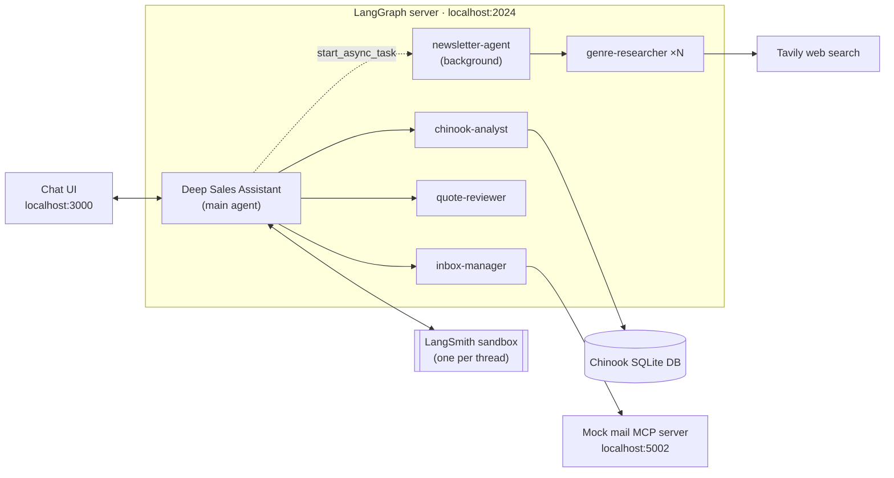

# Deep Sales Assistant

[](https://github.com/wasif1024/Deep-Sales-Assistant/actions/workflows/ci.yml)
[](LICENSE)


**Build a sandboxed AI sales agent with LangChain Deep Agents.**

Deep Sales Assistant handles day-to-day sales work for Jane, a sales rep at
Chinook (a sample online music store). It reads quote requests from her inbox,
prices them from a real database, gets the math double-checked, and drafts
the reply for her approval. It can also write a territory report with a chart,
and produce a weekly newsletter in the background while you keep chatting.

Everything the agent writes or runs happens inside its own **LangSmith
sandbox**, a separate cloud machine for each conversation, so nothing touches
your computer's files.

<p align="center">
  
</p>

<p align="center"><sub>
  The newsletter is researched in the background while the main agent keeps
  working in its own sandbox. <a href="docs/tutorial/06-background-newsletter.md">How it works →</a>
</sub></p>

## What you'll learn

- **Deep Agents** (`create_deep_agent`): planning, a virtual filesystem, and
  delegating to subagents
- **Specialist subagents**, each with its own tools, model, and memory
- **Human-in-the-loop approvals** for risky actions (adding a customer,
  saving an email draft)
- **Skills**: step-by-step playbooks the agent loads when it needs them
- **Sandboxed code execution** with a separate LangSmith sandbox per thread
- **Async subagents**: a background job you can check on later
- **MCP**: connecting the agent to a mail server through the Model Context
  Protocol

## How it fits together



| Component | What it does |
|---|---|
| **Main agent** | Plans the work, follows the skills, and delegates to the specialists. Has a code interpreter for exact arithmetic. |
| **chinook-analyst** | The only agent that can query the database. Adding a customer needs your approval. |
| **inbox-manager** | The only agent with email tools. Saving a draft needs your approval. |
| **quote-reviewer** | Checks a quote's math and prices before it's sent. |
| **newsletter-agent** | Runs in the background. Researches genres in parallel and returns finished HTML. |
| **LangSmith sandbox** | The agent's filesystem and the place its scripts run (charts, reports, files). |

---

## Setup

Plan on about 15 minutes for a first setup.

### 1. Install the prerequisites

| Tool | Version | Check with |
|---|---|---|
| Git | any | `git --version` |
| Python | 3.11 – 3.14 | `python3 --version` |
| [uv](https://docs.astral.sh/uv/) (Python package manager) | latest | `uv --version` |
| [Node.js](https://nodejs.org) | 20 or later | `node --version` |
| [pnpm](https://pnpm.io) | latest | `pnpm --version` |

**macOS**

```bash
# Homebrew: https://brew.sh
brew install git python node uv
npm install -g pnpm
```

**Linux**

```bash
# Install Git, Python 3.11+, and Node.js 20+ with your package manager
# (or Node from https://nodejs.org), then:
curl -LsSf https://astral.sh/uv/install.sh | sh
npm install -g pnpm
```

**Windows**

Use [WSL](https://learn.microsoft.com/windows/wsl/install) (Ubuntu) and
follow the Linux steps. `start.sh` is a bash script and won't run in
PowerShell.

### 2. Get your API keys

| Key | Required? | Where to get it | Used for |
|---|---|---|---|
| `ANTHROPIC_API_KEY` | **Yes** | [console.anthropic.com](https://console.anthropic.com) → API Keys | The chat models (Claude) |
| `LANGSMITH_API_KEY` | **Yes** | [smith.langchain.com](https://smith.langchain.com) → Settings → API Keys | Sandboxes, tracing, and the UI's file panel |
| `TAVILY_API_KEY` | Optional | [tavily.com](https://tavily.com) (has a free tier) | Web research for the newsletter |

Without a Tavily key everything works **except the newsletter**.

> [!IMPORTANT]
> **Sandboxes must be enabled for your LangSmith organization.** A valid key
> isn't enough. If Sandboxes isn't enabled, every chat fails with
> `SandboxAuthenticationError` ("Sandbox feature is not enabled for this
> organization"). After step 3, run the check in
> [Verify your setup](#5-verify-your-setup). If it fails, look for
> Sandboxes in your LangSmith workspace and request access there.

### 3. Clone and install

```bash
git clone https://github.com/wasif1024/Deep-Sales-Assistant.git
cd Deep-Sales-Assistant
uv sync
```

`uv sync` creates a `.venv/` folder and installs the Python dependencies. The
chat UI's Node packages are installed automatically the first time you run
`./start.sh`.

### 4. Configure your environment

```bash
cp .env.example .env
```

Open `.env` and fill it in:

```bash
ANTHROPIC_API_KEY=sk-ant-...
LANGSMITH_API_KEY=lsv2_...
LANGSMITH_TRACING=true                    # send traces to LangSmith (recommended)
LANGSMITH_PROJECT=deep-sales-assistant    # the LangSmith project traces go to
TAVILY_API_KEY=tvly-...                   # optional
```

`.env` is listed in `.gitignore`, so it won't be committed.

### 5. Verify your setup

Check that your LangSmith key works **and** your organization has Sandboxes:

```bash
uv run python -c "from dotenv import dotenv_values; from langsmith.sandbox import SandboxClient; print('Sandboxes OK:', SandboxClient(api_key=dotenv_values('.env')['LANGSMITH_API_KEY']).list_sandboxes())"
```

- `Sandboxes OK: []` (or a list): you're ready.
- `SandboxAuthenticationError: Sandbox feature is not enabled for this organization`:
  Sandboxes isn't enabled yet. See the note in step 2.
- `SandboxAuthenticationError` with any other message: the key is wrong or
  belongs to a different workspace.

### 6. Run it

```bash
./start.sh
```

This starts three services:

| Service | Address | What it is |
|---|---|---|
| Mock mail server | `http://127.0.0.1:5002` | Jane's inbox, as an MCP server |
| Chat UI | `http://localhost:3000` | Where you talk to the agent |
| LangGraph server | `http://localhost:2024` | Runs the agent (`langgraph dev`) |

When the logs show the LangGraph server is ready, open:

**<http://localhost:3000/?apiUrl=http://localhost:2024&assistantId=agent>**

`langgraph dev` may also open LangGraph Studio in your browser. You can use
it to look at the graph, but use the chat UI above for conversations.

---

## Your first conversation

The inbox starts with one email: a quote request from a new customer. Try
these prompts in order, in the same thread.

### 1. Process a quote request

> Process the new quote request in my inbox.

What to expect:
1. The agent makes a todo list and has **inbox-manager** read the email.
2. **chinook-analyst** searches for the customer and doesn't find them, so it
   calls `add_customer`. **An approval card appears.** Click **Approve**, or
   **Edit** to change the details first.
3. The analyst looks up real prices. The agent calculates the total with its
   code interpreter (with a 10% discount at 50+ tracks), and
   **quote-reviewer** checks the result.
4. **inbox-manager** saves the reply as a draft. **A second approval card
   appears** with the full email text, which you can edit before approving.
5. The quote is recorded in `/outputs/quotes_ledger.md`. You'll see it in the
   UI's **sandbox files** panel.

The first message in a thread takes a few extra seconds while its sandbox is
created.

### 2. Get a territory report

> Give me a territory report for my accounts.

The agent gathers the numbers, writes a Markdown report, then writes and runs
a Python script in the sandbox to draw a pie chart. The chart appears in the
chat, and both files can be downloaded from the sandbox files panel.

### 3. Create the newsletter (needs Tavily)

> Create this week's newsletter.

The agent starts **newsletter-agent** as a background task and answers right
away. A status badge shows the task's progress. Keep chatting, and after a
minute or two ask:

> Is the newsletter ready?

The agent collects the HTML and saves it to `/outputs/newsletter-<timestamp>-<id>.html`.

---

## Useful commands

```bash
# Reset the mock mailbox (clears drafts and restores the sample email)
uv run python mail_server/send_to_inbox.py --reset

# Send Jane a new customer email
uv run python mail_server/send_to_inbox.py \
  --from "Sam Lee <sam@example.com>" \
  --subject "Quote for Jazz tracks" \
  --body "Hi Jane, could you price 30 Jazz tracks for our restaurant?"

# Stop any sandboxes that are still running (start.sh does this on exit)
uv run python stop_sandboxes.py

# Lint and test
uv run ruff check .
uv run pytest
```

**Tests.** The tests in `tests/` need no API keys and make no model or
sandbox calls, so they're fast and free. They check the SQL guardrails
(writes rejected, inserts parameterized, new customers assigned to Jane),
HTML sanitizing, the mock mailbox (no send tool), approval gates on the right
subagents, the skills' front matter, and that both graphs load. GitHub
Actions runs them on Python 3.11 and 3.14, and lints and builds the chat UI,
on every push and pull request.

**Traces.** With `LANGSMITH_TRACING=true`, every run is recorded in
[LangSmith](https://smith.langchain.com) under the `deep-sales-assistant`
project. A trace shows every model call, tool call, subagent call, and
approval.

**Switching models.** Edit `models.py`. `model` is used by the lighter
subagents and `strong_model` by the main agent and quote-reviewer. Any
[LangChain chat model](https://python.langchain.com/docs/integrations/chat/)
will work if you install its package and add its key to `.env`.

## Stopping and costs

Press **Ctrl-C** in the terminal running `./start.sh`. It stops the mail
server, the UI, and `langgraph dev`, then **stops every running sandbox** this
project created.

If a sandbox is left running anyway (for example, after a crash), it stops on
its own after **10 idle minutes** and is deleted **1 hour** after stopping.
You can change these limits in `agent.py` (`SANDBOX_IDLE_TTL_SECONDS`,
`SANDBOX_DELETE_AFTER_STOP_SECONDS`).

Model usage is billed by Anthropic, and sandbox compute by LangSmith. One run
through the three prompts above uses a modest number of tokens.

## Troubleshooting

<details>
<summary><b><code>SandboxAuthenticationError</code> / "An internal error occurred" in the chat</b></summary>

The LangSmith API refused the sandbox request. Run the check in
[Verify your setup](#5-verify-your-setup):

- *"Sandbox feature is not enabled for this organization"*: your key is fine,
  but your organization doesn't have Sandboxes. Request access in LangSmith,
  or use a key from an organization that has it.
- Any other message: check `LANGSMITH_API_KEY` in `.env`. After changing it,
  restart `./start.sh`.
</details>

<details>
<summary><b>"Port 3000 / 5002 is in use"</b></summary>

`start.sh` stops whatever is using those ports. If something keeps
restarting on them, find it with `lsof -i :3000` and stop it yourself. Port
2024 (`langgraph dev`) isn't freed automatically; if it's taken, stop the old
`langgraph dev` process.
</details>

<details>
<summary><b>The chat UI won't load, or says it can't connect</b></summary>

- Wait until the logs show the LangGraph server is ready on port 2024.
- Make sure the URL includes `apiUrl=http://localhost:2024&assistantId=agent`.
- If `pnpm install` failed, run it yourself: `cd ui && pnpm install`.
</details>

<details>
<summary><b>The agent says the newsletter isn't available</b></summary>

`TAVILY_API_KEY` isn't set. Add it to `.env` and restart `./start.sh`.
</details>

<details>
<summary><b>The agent says it can't reach the mailbox</b></summary>

The mail server on port 5002 isn't running. It's started by `./start.sh`,
before `langgraph dev`. Restart the script and look for errors near
"Starting the mock mail server".
</details>

<details>
<summary><b>uv warns: <code>VIRTUAL_ENV=... does not match the project environment</code></b></summary>

Another project's virtual environment is active in your shell. It's harmless
because uv uses this project's `.venv`. To get rid of the warning, run
`deactivate` or open a new terminal.
</details>

---

## Project layout

```
deep-sales-assistant/
├── agent.py                  # Main agent: graph factory, one sandbox per thread
├── subagents.py              # chinook-analyst, inbox-manager, quote-reviewer
├── newsletter_agent_graph.py # Background newsletter agent (its own graph)
├── async_research.py         # Lets the main agent start background tasks
├── models.py                 # Which chat models to use
├── AGENTS.md                 # The agent's operating manual (loaded as memory)
├── skills/                   # Step-by-step playbooks
│   ├── rfq-quote/
│   ├── territory-report/
│   └── weekly-newsletter/
├── tools/
│   ├── sql.py                # Read-only queries + approval-gated add_customer
│   ├── html.py               # Markdown → sanitized HTML
│   └── search.py             # Tavily web search
├── mail_server/              # Mock mail MCP server + sample email
├── data/chinook.db           # Sample music-store database
├── ui/                       # Chat UI (modified agent-chat-ui)
├── tests/                    # pytest suite (no API keys needed)
├── .github/workflows/ci.yml  # Lint, test, and UI build on every push
├── langgraph.json            # Graphs the LangGraph server loads
├── start.sh                  # Starts everything
└── stop_sandboxes.py         # Stops this project's sandboxes
```

## Tutorial

To learn how it's built, read the chapters in order:

1. [Architecture overview](docs/tutorial/01-architecture.md)
2. [Tools and guardrails](docs/tutorial/02-tools-and-guardrails.md)
3. [Subagents and approvals](docs/tutorial/03-subagents-and-approvals.md)
4. [Skills and memory](docs/tutorial/04-skills-and-memory.md)
5. [A sandbox per thread](docs/tutorial/05-sandbox-per-thread.md)
6. [Background tasks: the newsletter](docs/tutorial/06-background-newsletter.md)
7. [Connecting email with MCP](docs/tutorial/07-mail-over-mcp.md)

## Acknowledgements

Inspired by the LangChain Academy Deep Agents course. The chat UI is adapted
from [agent-chat-ui](https://github.com/langchain-ai/agent-chat-ui) (MIT), and
the sample data is the [Chinook Database](https://github.com/lerocha/chinook-database)
(MIT). See [ACKNOWLEDGEMENTS.md](ACKNOWLEDGEMENTS.md).

## License

[MIT](LICENSE)
