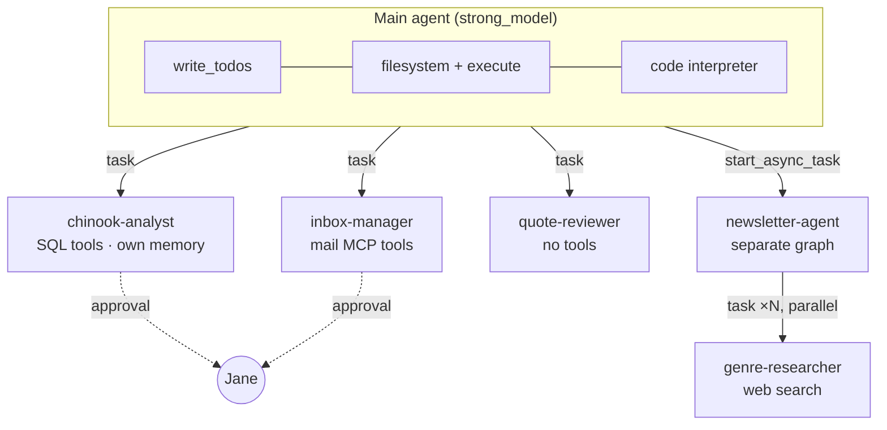

# 1. Architecture overview

[← README](../../README.md) · [Next: Tools and guardrails →](02-tools-and-guardrails.md)

This chapter is a map of the project. The later chapters cover each part in
detail. If you haven't run the agent yet, follow the
[setup in the README](../../README.md#setup) first; it helps to have seen it
work.

## The problem

Jane is a sales rep. Every week she:

- answers quote requests: reads the email, looks up prices, calculates a
  total, and replies
- adds new customers to the database
- sends customers a "This Week in Music" newsletter
- reports on how her accounts are doing

Each of these takes several steps and several systems (email, a database,
the web), and some steps shouldn't happen without her approval. A single
prompt with a few tools can't handle all of that reliably. It needs
**planning, delegation, files, and checkpoints**, which is what a deep agent
provides.

## What `create_deep_agent` gives you

[Deep Agents](https://github.com/langchain-ai/deepagents) is a layer on top of
LangGraph. One `create_deep_agent(...)` call gives the agent:

| Built in | What it does here |
|---|---|
| `write_todos` | The agent plans a quote as a visible checklist. |
| Filesystem tools (`ls`, `read_file`, `write_file`, `edit_file`, `glob`, `grep`) | Reports, the quotes ledger, and newsletters are saved as files. |
| `task` (subagents) | The main agent hands work to specialists that each have their own context. |
| Pluggable **backends** | Decide where those files actually live. Here: a LangSmith sandbox. |
| `execute` | Runs shell commands. Added automatically when the backend supports it. |
| **Memory** and **skills** | `AGENTS.md` is always loaded; skills are loaded when needed. |

Everything else in this project builds on these.

## The parts

| File | Role |
|---|---|
| `agent.py` | Builds the main agent. A new graph is built for each run, so each thread gets its own sandbox. |
| `subagents.py` | Defines the three specialists and their approval rules. |
| `newsletter_agent_graph.py` | A second graph, run as a background job. |
| `async_research.py` | Gives the main agent the tools to start and check that job. |
| `AGENTS.md` | Memory: who the agent works for, its team, and its rules. |
| `skills/*/SKILL.md` | Playbooks for each kind of task. |
| `tools/` | Python tools: SQL, HTML rendering, web search. |
| `mail_server/` | A mock mailbox exposed through MCP. |

## Following one request

What happens when Jane types *"Process the new quote request in my inbox"*:

1. The UI sends the message to the LangGraph server (`langgraph dev`).
2. The server calls `make_graph` in `agent.py`. It finds or creates this
   thread's sandbox and builds the agent around it.
3. The agent sees that the request matches the `rfq-quote` skill's
   description, reads `/skills/rfq-quote/SKILL.md`, and writes a todo list.
4. It hands each step to a specialist with `task`: inbox-manager reads the
   email, and chinook-analyst looks up the customer.
5. chinook-analyst calls `add_customer`. The run **pauses** and the UI shows
   an approval card. Jane approves, and the run continues.
6. The agent calculates the quote with the code interpreter,
   **quote-reviewer** checks it, and inbox-manager saves the draft (a second
   pause for approval).
7. The agent appends a row to `/outputs/quotes_ledger.md` in the sandbox. The
   UI's sandbox files panel lists it.

Each step is recorded as a span in the LangSmith trace.

## Design choices

- **Specialists own outside systems.** Only chinook-analyst can reach the
  database and only inbox-manager can reach email. That keeps each
  specialist's context small and puts each approval gate in one place.
  [Chapter 3](03-subagents-and-approvals.md) explains why this matters for
  safety.
- **Money is never calculated by the model in its head.** The agent uses a
  code interpreter so totals are exact.
- **Files go in the sandbox, not on your machine.** Generated scripts run in
  an isolated cloud environment ([chapter 5](05-sandbox-per-thread.md)).
- **Slow work runs in the background.** The newsletter takes minutes, so it
  doesn't hold up the chat ([chapter 6](06-background-newsletter.md)).
